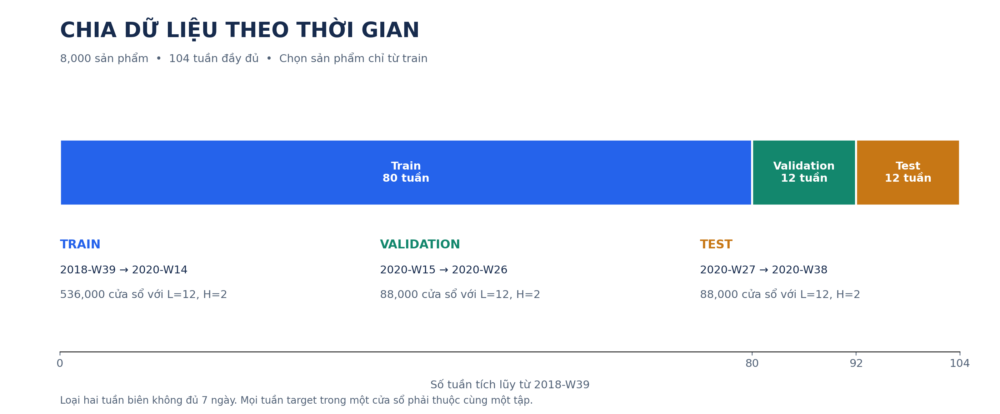

# Transformer cho Dự báo Nhu cầu Bán lẻ trong Điều kiện Thiếu Dữ liệu Đa phương thức

Demo đồ án tốt nghiệp, phát triển bằng VS Code và chạy trích xuất/huấn luyện trên Kaggle. Phiên bản **v2** sửa chọn mẫu có nhìn tương lai, đồng bộ dữ liệu/embedding và protocol đánh giá.

## Tình trạng hiện tại

- Đã dựng lại dữ liệu H&M: **8.000 sản phẩm, 104 tuần đầy đủ**, chọn mẫu chỉ trên train; split 80/12/12 tuần.
- Đã sửa pipeline Stage 1–3 và notebook, bổ sung kiểm định embedding, reproducibility và test end-to-end.
- Đã chạy Zero, Last-value và Moving Average trên toàn bộ test thật của v2.
- **Cần trích xuất lại embedding ảnh/text trên Kaggle.** Bộ local cũ có ảnh collapse và ID không đồng bộ; đã đánh dấu không hợp lệ.
- Chưa công bố kết quả learning baseline đa seed hoặc Multimodal Transformer; Stage 4–5 là phần tiếp theo.

## Workflow và hình minh họa



Xem [workflow, workload và kiến trúc dự kiến](docs/research_workflow.md). Tài liệu Stage 1–3 đã có sơ đồ Mermaid, bảng khối lượng công việc và hình từ dữ liệu thật. Các hình có cả PNG và SVG để dùng trong báo cáo.

## Bắt đầu

```bash
pip install -r requirements.txt
python -m src.pipeline.train_baselines --models zero last_value moving_average
```

Dữ liệu v2 đã có trong workspace hiện tại. Nếu tạo từ đầu:

```bash
python -m src.pipeline.run_stage1_stage2
```

Tiếp theo chạy notebook 02 trên Kaggle để tạo embedding v2; khi đã kiểm định xong, chạy notebook 03. Dependency riêng cho encoder nằm trong `requirements-extraction.txt`.

## Tài liệu

- [Giai đoạn 1: dữ liệu và split](docs/stage1_description.md)
- [Giai đoạn 2: ảnh thật, embedding và provenance](docs/stage2_description.md)
- [Giai đoạn 3: baseline, metric và hai protocol ablation](docs/stage3_description.md)
- [Hướng dẫn đưa v2 lên Kaggle](docs/kaggle_workflow.md)
- [Kết nối VS Code, Kaggle, GitHub và Overleaf](docs/integrations_local_kaggle_overleaf.md)
- [Biên bản sửa và kiểm chứng](docs/revision_v2.md)

## Lưu ý về phiên bản

`processed_data/v2/`, `embeddings/` và `results/v2/` là các artifact đang dùng. Không ghép embedding với danh sách sản phẩm từ một phiên bản dữ liệu khác. Hash và kiểm định runtime sẽ phát hiện dữ liệu không đồng bộ.

## Cấu trúc thư mục đang dùng

| Thư mục | Nội dung cần giữ |
| --- | --- |
| `raw_data/` | Dữ liệu H&M gốc để tái tạo Stage 1. |
| `processed_data/v2/` | Dữ liệu tuần, danh sách sản phẩm và metadata Stage 1 hợp lệ. |
| `embeddings/v2/` | Image/text embedding v2 và các file audit, metadata. |
| `results/v2/` | Run baseline deterministic và run học máy chính thức mới nhất. |
| `artifacts/kaggle/` | Hai gói upload Kaggle hiện hành và manifest. |
| `artifacts/report/` | Gói hình đã xuất cho báo cáo. |
| `docs/`, `notebooks/`, `scripts/`, `src/`, `tests/` | Mã nguồn, notebook, tài liệu và kiểm thử. |

Cache Python, output test, checkpoint cũ, artifact trùng và dữ liệu v1 không còn được giữ trong workspace. Chúng có thể tái tạo từ source và các dữ liệu v2 ở trên.

## Run kết quả cần dùng

| Run | Mục đích |
| --- | --- |
| `results/v2/20260916T150005Z_ea67e16e/` | Baseline deterministic, là nguồn của hình baseline hiện có. |
| `results/v2/20260920T085601Z_2c55ebb8/` | Run 3 seed gồm learning baselines và Multimodal MLP; dùng làm kết quả Stage 3 hiện tại. |

`demand` trong demo là lượng bán quan sát theo tuần. Không có dữ liệu tồn kho để suy ra toàn bộ nhu cầu tiềm ẩn hoặc nguyên nhân không có giao dịch.
