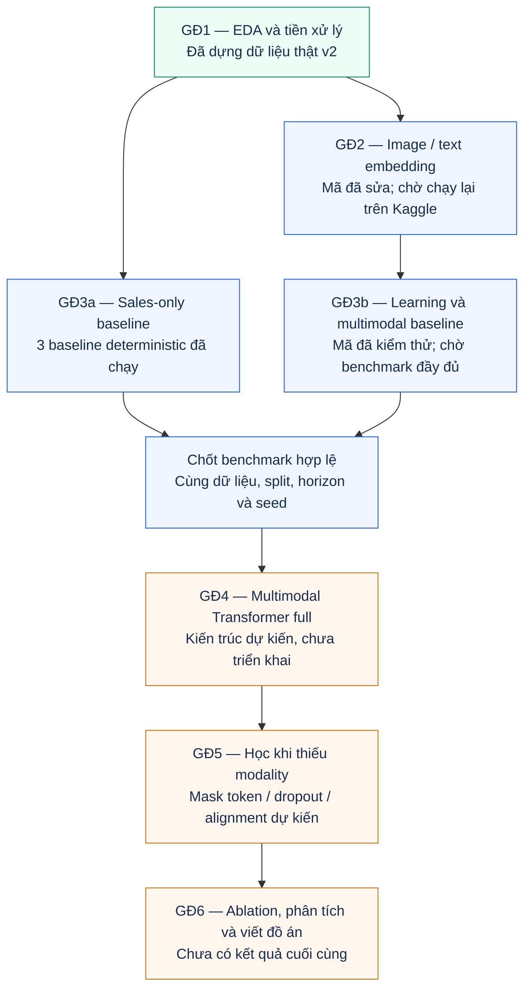
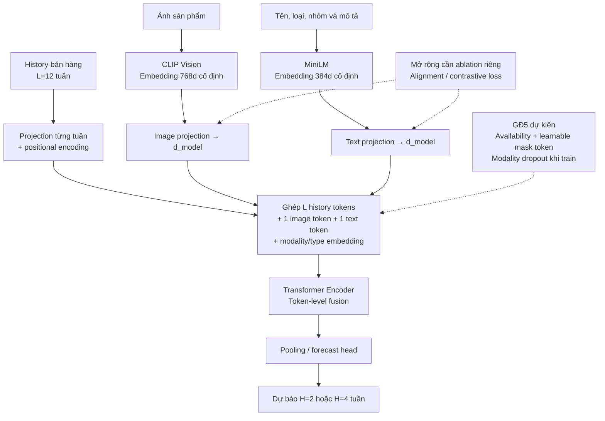

# Workflow và workload tổng thể của đồ án

Tài liệu này mô tả luồng nghiên cứu, đầu ra cần bàn giao và khối lượng thực nghiệm. Trạng thái bám theo các artifact v2 đã kiểm chứng; không dùng tỷ lệ hoàn thành ước lượng để thay cho kết quả thực tế.

## Lộ trình sáu giai đoạn



Xanh lá: đã có đầu ra dữ liệu thật. Xanh dương: mã/công việc đã có một phần nhưng còn thực nghiệm. Cam: công việc dự kiến. Các màu không biểu diễn mức độ tốt/xấu của mô hình.

## Bảng giao việc và điều kiện hoàn thành

| Giai đoạn | Việc chính                                                 | Phụ thuộc                        | Bằng chứng hoàn thành                                             | Trạng thái hiện tại                 |
| ----------- | ------------------------------------------------------------ | ---------------------------------- | --------------------------------------------------------------------- | --------------------------------------- |
| 1           | EDA, tuần ISO, train-only sampling, zero-filling            | CSV gốc                           | Index, selected, summary và hash hợp lệ                            | Đã chạy thật v2                     |
| 2           | Audit ảnh, CLIP/MiniLM, availability, provenance            | Danh sách v2 + ảnh thật         | Embedding không collapse; ID/hash khớp; độ phủ được báo cáo | Chờ chạy Kaggle                       |
| 3           | Baseline, 3 seed, 2 protocol missing                         | Dữ liệu; multimodal cần Stage 2 | CSV từng run, checkpoint, dự đoán và bảng mean/std              | Deterministic đã chạy; learning chờ |
| 4           | Projection và fusion bằng Transformer                      | Benchmark Stage 3 hợp lệ         | Mô hình full được train và so sánh cùng điều kiện          | Dự kiến                               |
| 5           | Mask token, modality dropout; alignment nếu phù hợp       | Full Transformer ổn định        | Ablation tách từng thành phần, cùng mask giữa các model        | Dự kiến                               |
| 6           | Phân tích theo nhóm, minh họa attention, viết báo cáo | Kết quả thực nghiệm thật      | Bảng/hình truy vết được về run; giới hạn được nêu rõ    | Dự kiến                               |

## Kiến trúc minh họa cho Stage 4–5 — chưa triển khai

Sơ đồ dưới chọn **token-level fusion** làm một hướng triển khai dễ kiểm soát. Đây là thiết kế đề xuất, không phải mô tả mô hình hiện đang có trong source.



Các mũi tên nét đứt là mở rộng Stage 5. Chưa mặc định chọn alignment là giải pháp tốt hơn; chỉ thêm sau khi có đối chứng full fusion và dropout. Nếu đổi sang cross-attention, cần cập nhật sơ đồ và mô tả kiến trúc tương ứng, không gọi hai thiết kế là một.

## Ma trận thí nghiệm để phát triển tiếp

| Nhóm model                            | Full                    | Mất ảnh                  | Mất text                  | Mất cả ảnh và text     | Cắt history giống nhau                     |
| -------------------------------------- | ----------------------- | -------------------------- | -------------------------- | -------------------------- | -------------------------------------------- |
| Sales-only baseline                    | Mốc đối chiếu       | Đối chiếu cùng history | Đối chiếu cùng history | Đối chiếu cùng history | Cần thêm đánh giá bị cắt tương ứng |
| Multimodal MLP                         | Đã có pipeline       | Đã có pipeline          | Đã có pipeline          | Đã có pipeline          | Đã có pipeline                            |
| Multimodal Transformer full            | Dự kiến               | Dự kiến                  | Dự kiến                  | Dự kiến                  | Dự kiến                                    |
| Transformer + mask/dropout             | Dự kiến               | Dự kiến                  | Dự kiến                  | Dự kiến                  | Dự kiến                                    |
| Transformer + mask/dropout + alignment | Tùy chọn sau ablation | Tùy chọn                 | Tùy chọn                 | Tùy chọn                 | Tùy chọn                                   |

“Đã có pipeline” chỉ nói mã thực nghiệm đã được viết và kiểm thử, không khẳng định đã có kết quả H&M thật. Trong same-checkpoint protocol, một model/seed được train một lần rồi đánh giá nhiều cột; không nhân số cột để tính số lần train.

## Tổ chức workload trên Kaggle

1. **Mốc dữ liệu:** upload source và Stage 1 v2; kiểm tra hash và đường dẫn.
2. **Mốc embedding:** chạy notebook 02; giữ audit, availability, revision và archive output.
3. **Mốc baseline:** đo tài nguyên bằng một lần chạy ngắn, sau đó chạy cấu hình chính thức. Learning baseline gồm 15 lần train; thêm retrained ablation là 24 lần train tổng cộng.
4. **Mốc full Transformer:** triển khai một kiến trúc fusion trước; kiểm tra bằng cùng split và chính sách checkpoint.
5. **Mốc missing modalities:** cố định các mask theo scenario, thêm từng thành phần và ghi ablation riêng. So partial history với sales-only bị cắt cùng điều kiện.
6. **Mốc báo cáo:** xuất mean/std theo seed, sai số theo horizon/nhóm, mức suy giảm và một số ví dụ dự báo có ID/tuần truy vết được.

Chưa đặt số giờ/ngày cố định vì chưa đo tốc độ encoder và train trên GPU tài khoản Kaggle của bạn. Thời gian thực tế cần lấy từ log/run_config; số epoch tối đa không phải số epoch chắc chắn sẽ chạy.

## Bộ hình dùng trong báo cáo

| Hình                | Mục đích                                                   | PNG                                   | SVG                                   |
| -------------------- | ------------------------------------------------------------- | ------------------------------------- | ------------------------------------- |
| Chia thời gian      | Giải thích 80/12/12 tuần và số cửa sổ                  | [PNG](figures/time_split_v2.png)       | [SVG](figures/time_split_v2.svg)       |
| Phân bố sản phẩm | Giải thích sampling theo nhóm                              | [PNG](figures/product_groups_v2.png)   | [SVG](figures/product_groups_v2.svg)   |
| So sánh baseline    | Minh họa các kết quả đã đo, chưa có model đề xuất | [PNG](figures/baseline_results_v2.png) | [SVG](figures/baseline_results_v2.svg) |

PNG phù hợp để chèn nhanh vào Word/slide; SVG giữ độ nét khi phóng lớn. Số liệu nguồn và SHA-256 nằm trong `figures/figure_sources.json`. Chỉ thay hình kết quả khi có run thật tương ứng.

Các sơ đồ Mermaid được nhúng trực tiếp trong Markdown để dễ sửa. Mở Markdown Preview trong trình xem hỗ trợ Mermaid; nếu trình xem hiện mã thay vì sơ đồ, các hình PNG/SVG vẫn dùng độc lập được.

## Tạo lại hình từ dữ liệu đã lưu

```bash
pip install -r requirements-figures.txt
python scripts/render_report_figures.py
```

Lệnh vẽ đọc metadata Stage 1 và run deterministic đã nêu trong hình; dừng nếu hash dữ liệu của hai nguồn không khớp. Để minh họa run khác, cần đổi nguồn kết quả và kiểm tra chú thích tương ứng trước khi xuất báo cáo.
