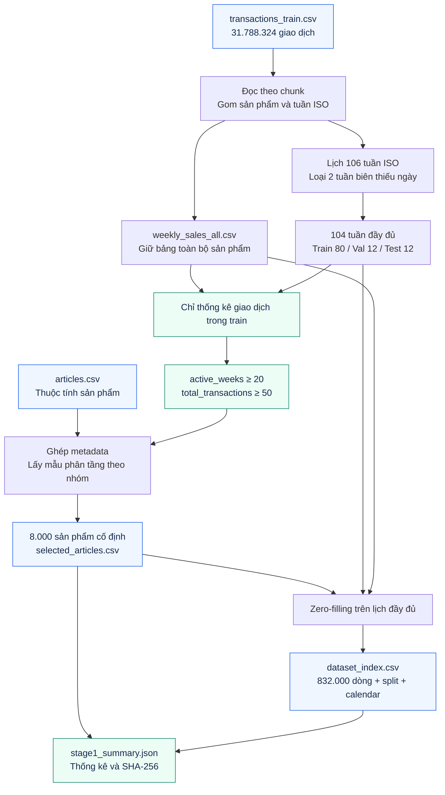
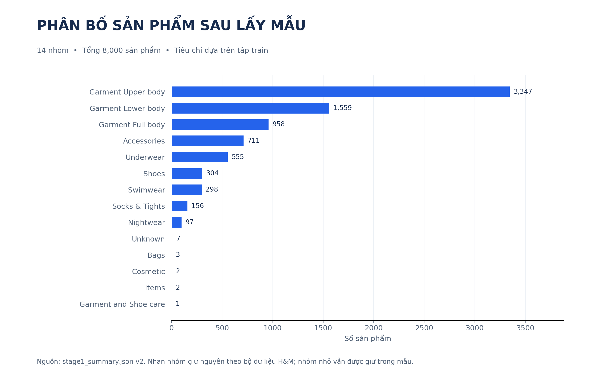

# Giai đoạn 1 — Khám phá và tiền xử lý dữ liệu v2

Đề tài: **Transformer cho Dự báo Nhu cầu Bán lẻ trong Điều kiện Thiếu Dữ liệu Đa phương thức**.

## Trạng thái đã thực hiện

Ngày 16/09/2026, pipeline v2 đã được chạy lại trên toàn bộ **31.788.324 giao dịch** trong dữ liệu local. Dữ liệu mới nằm trong `processed_data/v2/`; dữ liệu ở thư mục cha là phiên bản cũ để đối chiếu, không dùng chung với v2.

| Chỉ số | Kết quả v2 |
|---|---:|
| Khoảng giao dịch gốc | 20/09/2018–22/09/2020 |
| Số tuần ISO giao với khoảng dữ liệu | 106 |
| Số tuần đủ 7 ngày được sử dụng | 104 |
| Sản phẩm đủ tiêu chí trong train | 33.514 |
| Sản phẩm lấy mẫu | 8.000 |
| Nhóm sản phẩm sau lấy mẫu | 14 |
| Dòng trong dataset_index | 832.000 |
| Tỷ lệ demand bằng 0 | 60,1577% |
| Sản phẩm được chọn thiếu detail_desc | 38 |

Nguồn số liệu chính thức của mỗi lần dựng dữ liệu là `aggregation_metadata.json` và `stage1_summary.json`, không phải các số viết cố định trong notebook.

## Định nghĩa bài toán và giới hạn

`demand` là **số dòng giao dịch bán hàng quan sát được** theo sản phẩm/tuần. Không tự loại các dòng giao dịch trông giống nhau, vì một lượt mua có thể chứa nhiều đơn vị hàng. Dữ liệu không cho biết tồn kho, thời điểm mở bán chính xác hoặc nhu cầu không được đáp ứng. Do đó số 0 không chứng minh nhu cầu tiềm ẩn bằng 0.

Ma trận zero-filled mô tả doanh số quan sát của tập sản phẩm cố định. Những tuần trước khi sản phẩm bắt đầu bán vẫn có giá trị 0 theo quy ước này. Không được dùng zero-filling như bằng chứng sản phẩm đã sẵn hàng trong tuần đó. Bộ mẫu ưu tiên sản phẩm có lịch sử bán, chưa đại diện cho cold-start tự nhiên; các thí nghiệm cắt lịch sử sau này là thiếu dữ liệu mô phỏng.

## Minh họa workflow Stage 1



*Mũi tên thể hiện luồng dữ liệu; các tiêu chí chọn sản phẩm chỉ nhìn tập train. Zero-filling sử dụng lịch của cả ba tập nhưng không dùng target tương lai để chọn sản phẩm.*



**Hình 1.1.** Phân bố 8.000 sản phẩm thuộc 14 nhóm sau sampling. Nhóm lớn vẫn chiếm ưu thế do lấy mẫu theo tỷ trọng; các nhóm nhỏ được giữ khi ngân sách cho phép. [Bản SVG để chèn báo cáo](figures/product_groups_v2.svg).

## Quy trình và chống rò rỉ dữ liệu

1. `src/data/eda.py` đọc giao dịch theo chunk, thống kê ngày, số giao dịch theo sản phẩm, nhóm hàng và mô tả thiếu. Có thể xuất JSON/CSV để làm hình trong báo cáo.
2. `src/data/build_weekly_sales.py` chỉ đọc `article_id` và `t_dat`, mặc định mỗi chunk một triệu dòng. Cộng các nhóm sản phẩm/tuần giữa các chunk, tránh nạp toàn bộ CSV 3,5 GB cùng lúc.
3. Tạo lịch tuần liên tục từ khoảng ngày gốc. Dùng ISO year và ISO week, tránh sai năm quanh tháng 12/tháng 1.
4. Loại `2018-W38` và `2020-W39` vì dữ liệu không phủ đủ thứ Hai–Chủ nhật. Giữ `2018-W39` đến `2020-W38`.
5. Gán split theo ngày trong `src/data/splits.py`. Cấu hình duy nhất nằm ở `src/config.py`.
6. **Chỉ tính active_weeks và total_transactions trên các tuần train đầy đủ.** Lọc `active_weeks >= 20`, `total_transactions >= 50`.
7. Lấy mẫu phân tầng theo `product_group_name`, seed 42. Phân bổ chính xác 8.000 sản phẩm; giữ ít nhất một sản phẩm cho mỗi nhóm nếu ngân sách mẫu cho phép. Nếu số ứng viên nhỏ hơn mục tiêu thì lấy toàn bộ và ghi số thực tế.
8. Chuẩn hóa văn bản một lần tại Stage 1. Ghép tên, loại, nhóm và mô tả; fallback sang các trường hiện có. Lưu cả `text_for_embedding` và `text_available`. Thiếu detail_desc không đồng nghĩa thiếu toàn bộ text modality.
9. Tạo tích Descartes sản phẩm × lịch tuần đầy đủ, ghép giao dịch và điền 0. Bổ sung `week_start`, `week_end`, `week_of_year`, `month`, `week_sin`, `week_cos`, `is_complete_week`, `split`.
10. Lưu SHA-256 của danh sách sản phẩm và index. Loader xác minh hash trước khi train.

Không overwrite bảng tuần toàn bộ sản phẩm sau khi lấy mẫu. Có thể thay đổi cấu hình rồi chọn lại từ cùng bảng tổng hợp gốc.

## Split chính thức

| Tập | Khoảng tuần | Ngày cuối tập | Số tuần |
|---|---|---|---:|
| Train | 2018-W39–2020-W14 | 05/04/2020 | 80 |
| Validation | 2020-W15–2020-W26 | 28/06/2020 | 12 |
| Test | 2020-W27–2020-W38 | 20/09/2020 | 12 |

Cutoff phải là Chủ nhật. Loader không tạo split theo tỷ lệ khác hoặc tự dùng 88/10 tuần như phiên bản cũ. Khi đổi ngày chia, phải tạo lại Stage 1; danh sách sản phẩm và embedding có thể phải được tạo lại.


**Hình 1.2.** Tỷ lệ độ dài thanh tương ứng 80/12/12 tuần. Số cửa sổ được tính với L=12 và H=2; đây không phải số tuần hoặc số giao dịch. [Bản SVG](figures/time_split_v2.svg).

## Workload Stage 1

| Công việc | Khối lượng / đầu ra | Trạng thái |
|---|---|---|
| Đọc và tổng hợp dữ liệu gốc | 31.788.324 dòng giao dịch; đọc theo chunk | Đã chạy thật |
| Chuẩn hóa lịch và split | 106 tuần lịch → 104 tuần đầy đủ; 80/12/12 | Đã chạy thật |
| Lọc ứng viên trên train | 33.514 ứng viên thỏa ngưỡng | Đã chạy thật |
| Lấy mẫu và xây index | 8.000 sản phẩm; 832.000 dòng | Đã chạy thật |
| Xuất metadata và kiểm tra tính toàn vẹn | Hash selected/index; kiểm tra split và ranh giới cửa sổ | Đã có và đã kiểm thử |
| Chọn lại mẫu khi đổi cấu hình | Chạy lại từ weekly_sales_all, sau đó tạo lại artifact phụ thuộc | Chỉ thực hiện nếu đổi thiết kế |

Xem [workload tổng thể](research_workflow.md) để theo dõi phụ thuộc giữa các giai đoạn.

## File đầu ra

- `weekly_sales_all.csv`: tổng hợp tất cả sản phẩm, giữ cả tuần biên để truy vết.
- `week_calendar.csv`: lịch tuần và dấu hiệu tuần đầy đủ.
- `weekly_sales_selected.csv`: bán hàng của tập mẫu trong những tuần được sử dụng.
- `selected_articles.csv`: metadata, thống kê **train-only**, văn bản và text availability.
- `dataset_index.csv`: ma trận dài có zero-filling, lịch và split.
- `aggregation_metadata.json`: khoảng ngày, số giao dịch và chính sách target.
- `stage1_summary.json`: cấu hình, thống kê, phân bố nhóm, split và hash.

## Chạy bằng VS Code hoặc Kaggle

Từ thư mục gốc project:

```bash
python -m src.pipeline.run_stage1_stage2
```

Mặc định đọc `raw_data/`, ghi `processed_data/v2/`. Nếu đã có bảng tổng hợp toàn bộ và lịch tuần:

```bash
python -m src.pipeline.run_stage1_stage2 --reuse-aggregation
```

Chạy EDA tùy chọn:

```bash
python -m src.data.eda
```

Notebook `notebooks/01_eda.ipynb` dùng cùng các hàm, không chứa phiên bản xử lý dữ liệu riêng. Trên Kaggle, Input chỉ dùng để đọc; kết quả nằm trong `/kaggle/working/`. Cell cuối xuất archive mới.

## Điều kiện chuyển sang Stage 2

Sử dụng chính xác `selected_articles.csv` của v2 để trích xuất. Không chỉnh sửa CSV bằng Excel sau khi tạo hash. Khi danh sách hoặc văn bản thay đổi, cần trích xuất lại; không chỉ đổi trường hash trong metadata để vượt qua kiểm tra.

Quy mô 8.000 giữ cho demo và chi phí Kaggle; đây là điều chỉnh so với mục tiêu 10.000–15.000 ban đầu. Có thể mở rộng sau khi có benchmark ổn định, bằng cách đổi `DataConfig.target_sample_size` và chạy lại các bước phụ thuộc.
