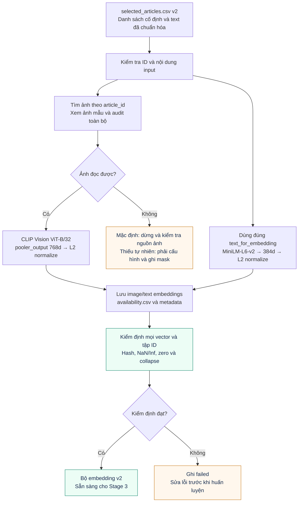

# Giai đoạn 2 — Trích xuất và kiểm định embedding v2

## Trạng thái và lỗi dữ liệu cũ

Pipeline trích xuất đã được sửa, nhưng **embedding v2 từ ảnh thật chưa được tạo trong phiên làm việc local này**. Cần chạy `notebooks/02_MultiModal_Vector.ipynb` trên Kaggle, nơi có bộ ảnh H&M và các encoder.

Kiểm tra bộ local cũ trước khi chuyển sang v2:

| Chỉ số | Ảnh cũ | Text cũ |
|---|---:|---:|
| Số key embedding | 7.999 | 7.999 |
| Khớp với 8.000 sản phẩm trong CSV cũ | 2.053 | 2.053 |
| Sản phẩm của CSV cũ thiếu embedding | 5.947 | 5.947 |
| Số vector phân biệt | **1** | 6.432 |

Các số này đối chiếu với danh sách **cũ**, không phải danh sách v2 vừa chọn lại. `embeddings/legacy_audit.json` lưu kết quả và hash. `embeddings/metadata.json` cũ đã được đánh dấu `failed`, không còn công bố kiểm định thành công.

Toàn bộ vector ảnh cũ giống nhau, khác vector 0. Việc thay mọi ảnh đọc lỗi bằng ảnh đen là một nguyên nhân có khả năng cao; chưa xác nhận nguyên nhân trực tiếp trên Kaggle. Không sử dụng checkpoint đa phương thức cũ để kết luận lợi ích ảnh, cũng không tái sử dụng bộ text cũ cho danh sách mới.

## Quy trình mới

Mã trích xuất nằm trong `src/features/extract_embeddings.py`; notebook chỉ cấu hình đường dẫn, xem ảnh và gọi hàm chung.

1. Đọc đúng `selected_articles.csv` v2, kiểm tra ID 10 chữ số, không trùng, không thiếu.
2. Hiển thị 10 ảnh thật trong notebook trước khi trích xuất.
3. Kiểm tra toàn bộ đường dẫn `images/{article_id[:3]}/{article_id}.jpg`; đọc và giải mã ảnh thật.
4. Lưu `image_audit.json` và `availability.csv`, phân biệt `ok`, `missing`, `unreadable`.
5. Mặc định dừng nếu có ảnh không đọc được (`max_missing_image_fraction=0.0`). Nếu nghiên cứu thiếu tự nhiên, có thể đặt ngưỡng rõ ràng; phải báo cáo độ phủ và không gọi đó là tập full modalities.
6. Chỉ đưa **ảnh thật có sẵn** vào encoder. Ảnh thiếu dùng zero placeholder trực tiếp cùng `image_available=False`, tuyệt đối không encode ảnh đen thay thế.
7. Text dùng nguyên cột `text_for_embedding` từ Stage 1, không ghép lại theo công thức khác trên Kaggle.
8. Kiểm tra chất lượng và provenance sau khi xuất. Chỉ công bố `passed` sau khi kiểm định thành công.

## Minh họa workflow Stage 2



*Sơ đồ mô tả pipeline đã có mã. Encoder thực tế vẫn phải được chạy lại trên Kaggle cho danh sách v2. 768d và 384d là hai không gian khác nhau, chưa có alignment học được.*

## Workload Stage 2

| Công việc | Khối lượng / đầu ra mong đợi | Trạng thái |
|---|---|---|
| Kiểm tra đường dẫn và xem ảnh | 10 ảnh minh họa, audit 8.000 sản phẩm | Mã đã có; chờ chạy trên Kaggle |
| Trích xuất ảnh | Tối đa 8.000 vector 768d từ ảnh thật | Chờ chạy |
| Trích xuất text | Tối đa 8.000 vector 384d theo text_available | Chờ chạy |
| Ghi provenance và độ phủ | Hash selected, embedding, availability; revision encoder | Mã đã có |
| Kiểm định và đóng gói | metadata, audit, validation report và archive mới | Mã đã có; chờ kết quả thật |

Với batch size 64 và mọi modality đều có sẵn, mỗi encoder xử lý **125 batch**. Đây là số batch tính từ 8.000 sản phẩm, không phải ước lượng thời gian GPU. Encoder chỉ cần trích xuất một lần cho cùng danh sách, văn bản và revision; các seed huấn luyện tái sử dụng cùng bộ embedding.

## Encoder và không gian biểu diễn

| Modality | Encoder | Feature | Chiều |
|---|---|---|---:|
| Image | openai/clip-vit-base-patch32 | vision pooler_output, L2-normalized | 768 |
| Text | sentence-transformers/all-MiniLM-L6-v2 | sentence embedding, L2-normalized | 384 |

768d là đầu ra vision encoder trước visual projection, không phải lỗi so với ví dụ 512d của CLIP projected features. Image processor xử lý resize/crop theo cấu hình encoder và dùng `use_fast=False` để cố định lựa chọn preprocessing. Phiên bản thư viện, revision yêu cầu và commit được resolve của encoder được ghi vào metadata.

L2-normalize riêng không làm hai encoder có cùng không gian ngữ nghĩa. MiniLM không phải text encoder đã ghép cặp với CLIP Vision. Stage 4/5 cần projection học được và mục tiêu alignment phù hợp nếu muốn kéo hai modality lại gần nhau.

Tham khảo: [CLIP model/configuration](https://huggingface.co/docs/transformers/model_doc/clip).

## Kiểm định bắt buộc

`src/features/verify_embeddings.py` kiểm tra:

- Tập key của mỗi embedding phải bằng đúng tập sản phẩm được chọn, không thiếu và không thừa.
- Mọi vector, không chỉ vector đầu tiên, phải có chiều đúng và hữu hạn.
- Vector của quan sát có sẵn phải khác 0; vector của quan sát thiếu phải là zero placeholder.
- Phát hiện collapse: các vector của những quan sát có sẵn trùng hoàn toàn hoặc phương sai gần bằng 0.
- Hash của selected CSV, hai file embedding và availability phải đúng metadata.
- Full-modality baseline đòi hỏi cả ảnh và text đều sẵn cho mọi sản phẩm.

Loader huấn luyện gọi kiểm tra trực tiếp, không tin riêng chuỗi `validation: passed`. Vì vậy nhãn kiểm định cũ không thể làm bộ dữ liệu bị thay đổi vượt qua kiểm tra.

Kiểm tra phương sai không chứng minh encoder hiểu ngữ nghĩa đúng. Vẫn phải xem ảnh, kiểm tra mô tả và đánh giá lợi ích bằng thực nghiệm.

## File cần giữ cùng nhau

```text
embeddings/v2/
  image/image_embeddings.pt
  text/text_embeddings.pt
  availability.csv
  image_audit.json
  metadata.json
  validation_report.json
```

Giữ cấu trúc thư mục khi tải về hoặc upload thành Kaggle dataset. Không chỉ copy hai file `.pt`, vì loader còn cần provenance và availability.

## Chạy trên Kaggle

1. Gắn dataset source code mới và dataset Stage 1 v2; thêm H&M competition có thư mục ảnh.
2. Bật GPU; bật Internet khi cần tải encoder. Kiểm tra dòng thiết bị thực tế, không chỉ dựa vào cấu hình giao diện.
3. Nếu thiếu dependencies, cài `requirements-extraction.txt` đi kèm source. Sau khi đã có đúng thư viện, không cần cài lại mỗi lần chạy.
4. Mở notebook 02. Nếu gắn nhiều bộ dữ liệu cùng loại, đặt đường dẫn override rõ ràng; notebook dừng thay vì chọn ngẫu nhiên bộ đầu tiên.
5. Xem ảnh, chạy extraction và kiểm tra `validation_report.json`.
6. Tải `hm-embeddings-v2.zip` được tạo từ **thư mục output mới**, không lấy từ dataset embedding cũ trong Input.
7. Gắn archive mới làm input cho Stage 3 hoặc giải nén về `embeddings/v2/` local.

Có thể chạy module trực tiếp:

```bash
python -m src.features.extract_embeddings --selected-articles-path processed_data/v2/selected_articles.csv --images-dir /path/to/images --output-dir embeddings/v2
python -m src.features.verify_embeddings
```

Nếu audit ảnh thất bại, kiểm tra lại nguồn ảnh/path trước. Không tăng ngưỡng thiếu chỉ để vượt lỗi thư mục. Nếu chọn nghiên cứu thiếu tự nhiên có chủ ý, dùng `--allow-natural-missing` khi kiểm định và báo cáo số thiếu; pipeline full baseline mặc định vẫn sẽ từ chối bộ đó.
