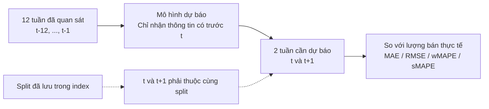
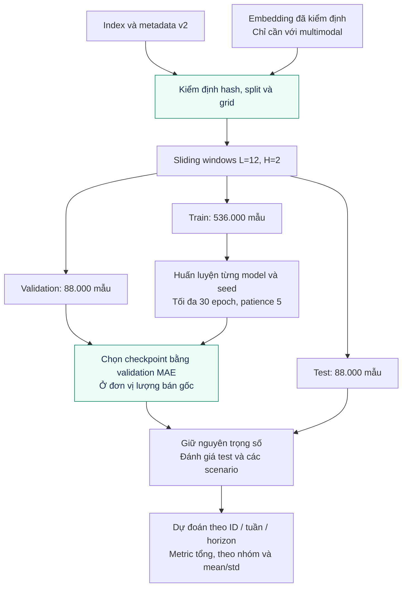
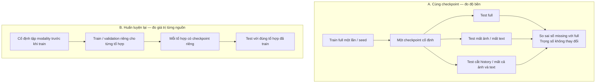
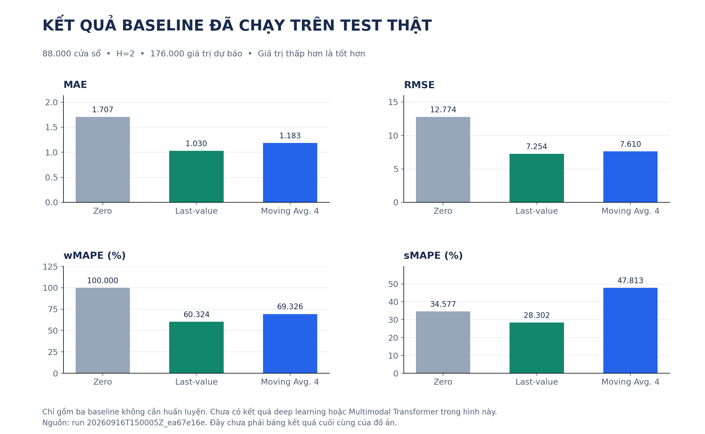

# Giai đoạn 3 — Baseline và đánh giá thiếu modality v2

## Trạng thái

Đã sửa data loader, baseline, trainer, metric, hai protocol ablation và notebook. Đã chạy kiểm thử end-to-end trên dữ liệu nhỏ có embedding giả để kiểm tra luồng xử lý, **không xem kết quả đó là kết quả nghiên cứu**. Ba baseline không cần huấn luyện đã được đánh giá trên toàn bộ test của dữ liệu H&M v2 thật.

Chưa chạy benchmark deep learning đầy đủ nhiều seed trên Kaggle và chưa có embedding ảnh thật v2. Vì vậy chưa thể kết luận multimodal tốt hơn time-series, hoặc giải pháp chịu thiếu modality có hiệu quả.

## Data loader và sliding windows

`src/data/dataset.py` kiểm tra schema v2, hash Stage 1, grid sản phẩm/tuần đầy đủ, demand hữu hạn không âm, tuần liên tục và split đúng cutoff. Không tự chia lại dữ liệu theo tỷ lệ.

Với L=12, H=2 và dữ liệu v2 hiện tại:

| Tập | Số tuần của tập | Số forecast origin mỗi sản phẩm | Số mẫu |
|---|---:|---:|---:|
| Train | 80 | 67 | 536.000 |
| Validation | 12 | 11 | 88.000 |
| Test | 12 | 11 | 88.000 |

Mọi H tuần target phải nằm trọn trong cùng split. Validation/test được dùng lịch sử đã quan sát trước thời điểm dự báo. Đây là **rolling-origin evaluation với checkpoint cố định**, không phải train lại mỗi tuần: tuần test trước có thể trở thành history của dự báo test sau, nhưng không được dùng tương lai của forecast origin.

Trường `forecast_origin` trong file kết quả được quy ước là **tuần dự báo đầu tiên**, ngay sau history. `target_week` và `horizon` cho biết rõ mỗi dự đoán. Cửa sổ target chồng lấn tạo nhiều dự đoán cho một tuần ở các horizon khác nhau; metric tổng hợp đánh giá từng cặp origin–horizon và có thêm metric theo horizon, không giả định các mẫu hoàn toàn độc lập.

Dataset lưu một ma trận float32 và danh sách origin, tạo cửa sổ khi truy cập. Không tạo hàng trăm nghìn dictionary giữ từng cửa sổ từ trước. Calendar sin/cos và availability được trả về để hỗ trợ mô hình sau này. **Baseline hiện tại chưa dùng calendar features**; chúng không được quảng bá là mô hình đã học mùa vụ chỉ vì index có các cột này.

Full multimodal phải xác minh bộ embedding v2 có đủ dữ liệu. Chế độ sales-only tắt việc nạp embedding; không cần embedding mới để chạy baseline chuỗi thời gian.

## Minh họa cửa sổ dự báo



**Ví dụ tại ranh giới validation:** dùng 12 tuần cuối train để dự báo hai tuần đầu validation. Sau khi thời gian tiến thêm một tuần, tuần validation vừa quan sát có thể vào history của dự báo sau; trọng số checkpoint vẫn giữ nguyên.

## Workflow huấn luyện baseline



*Test chỉ đi vào bước đánh giá; không dùng test để chọn checkpoint hoặc siêu tham số. Các baseline không cần huấn luyện đi trực tiếp từ history test đến đánh giá.*

## Các baseline

| Tên trong pipeline | Kiến trúc / quy tắc |
|---|---|
| zero | Dự báo 0, dùng để hiểu ảnh hưởng của dữ liệu thưa |
| last_value | Lặp giá trị cuối history |
| moving_average | Trung bình min(4,L) tuần gần nhất |
| linear | Một affine layer, không ReLU hoặc hidden layer |
| mlp | MLP sales-only |
| lstm | LSTM sales-only |
| transformer | Transformer Encoder với positional encoding, sales-only |
| multimodal_mlp | Ghép history, image embedding và text embedding qua MLP |

`SeasonalNaiveBaseline` hiện là seasonal naive thật, mặc định chu kỳ 52. Nó kiểm tra history đủ ít nhất 52 tuần; không nằm trong benchmark mặc định L=12. Không gọi last-value naive là seasonal naive nữa. Khi bổ sung benchmark chu kỳ 52, cần giữ cùng tập forecast origin để so sánh công bằng.

GRU vẫn có trong mã nguồn để mở rộng, nhưng chưa nằm trong runner mặc định. AutoARIMA và TCN chưa triển khai.

Nguồn định nghĩa: [Naive và Seasonal Naive](https://otexts.com/fpp3/simple-methods.html), [đánh giá dự báo theo thời gian](https://otexts.com/fpp3/tscv.html).

## Tiền xử lý và huấn luyện

- Mặc định các mô hình học dùng `log1p(history)` và MSE trên `log1p(target)`. Đây là phép biến đổi cố định, không fit trên validation/test.
- `linear` vì vậy là tuyến tính trong không gian log1p khi chọn cấu hình mặc định. Đặt `target_transform='none'` nếu cần benchmark hồi quy tuyến tính trực tiếp trên lượng bán gốc.
- Dự đoán được inverse bằng `expm1` rồi chặn giá trị âm về 0 trước khi tính metric. Cùng chính sách output cho các mô hình học.
- Validation MAE được tính ở **đơn vị lượng bán gốc** và dùng để chọn checkpoint. Tối ưu log-MSE nhưng chọn theo raw-MAE là quyết định có chủ đích, được ghi trong training metadata.
- Adam, learning rate mặc định 1e-3, gradient clipping norm 1.0. Train loss được tổng hợp theo số mẫu, không coi batch cuối ít mẫu ngang batch đầy.
- Mặc định tối đa 30 epoch, patience 5, seeds 42/43/44; cùng ngân sách cho các mô hình học và ablation.
- Seed áp dụng cho Python, NumPy, PyTorch và DataLoader. Bật chế độ deterministic với cảnh báo cho phép toán không hỗ trợ. Không cam kết bit-for-bit giữa mọi GPU/phiên bản thư viện; metadata lưu môi trường thực tế.
- Nonfinite loss hoặc prediction làm run thất bại rõ ràng. Không lặng lẽ tải checkpoint cũ nếu run hiện tại chưa tạo checkpoint hợp lệ.

Thay đổi scaling/loss là một cấu hình thực nghiệm. Chọn siêu tham số trên validation; không dùng nhiều lần xem test để chọn cấu hình tốt nhất.

## Hai protocol khác nhau

### 1. Same-checkpoint robustness

Huấn luyện full multimodal một lần cho mỗi seed, chọn checkpoint tốt nhất trên validation full, giữ nguyên trọng số rồi đánh giá:

| Scenario | Dữ liệu khi test |
|---|---|
| full | History + image + text |
| missing_image | History + text; vector ảnh bằng 0 |
| missing_text | History + image; vector text bằng 0 |
| partial_history | Chỉ giữ L//2 tuần gần nhất, che các tuần cũ |
| missing_image_and_text | History; hai embedding bằng 0 |

Với L=12, partial_history giữ 6 tuần gần nhất. Các mask được xác định cố định theo scenario nên giống nhau cho mọi seed và mẫu tương ứng; không phụ thuộc RNG của batch. History mask và availability có trong input, nhưng các baseline hiện dùng zero-imputation và bỏ qua mask token. Đây chưa phải giải pháp học chịu thiếu dữ liệu của Stage 5.

`robustness_comparison.csv` tính:

```text
MAE_increase_pct = 100 * (MAE_missing - MAE_full) / MAE_full
```

Nếu MAE_full=0 thì mức tăng phần trăm không xác định, lưu trống. Giá trị âm có nghĩa sai số giảm, không được ép thành 0.

### 2. Retrained modality ablation

Bật `retrained_ablation=True` hoặc `--retrained-ablation` để huấn luyện riêng:

- History + Image + Text: dùng kết quả full đã train với cùng ngân sách.
- History + Text: thiếu ảnh suốt train/validation/test.
- History + Image: thiếu text suốt train/validation/test.
- History only: thiếu cả hai embedding suốt train/validation/test.

Mỗi tổ hợp bắt đầu từ cùng seed và được huấn luyện, chọn checkpoint riêng. Protocol này đo giá trị của nguồn thông tin khi biết trước nguồn nào có sẵn; không diễn giải là suy giảm của cùng một mô hình khi mất modality.

Để trả lời còn tốt hơn time-series hay không, so MAE của multimodal missing-image/text với các baseline sales-only trên cùng test và horizon. Khi đánh giá partial-history, cần bổ sung đối chứng sales-only cũng bị cắt history giống hệt, không so với lịch sử đầy đủ rồi gọi là so sánh cùng điều kiện.

### Sơ đồ phân biệt hai protocol



*Không gộp hai nhánh thành một kết luận về độ bền: nhánh A đo phản ứng của cùng mô hình, nhánh B đo hiệu quả khi được học riêng theo nguồn có sẵn.*

## Workload thực nghiệm Stage 3

| Hạng mục | Cấu hình mặc định | Khối lượng |
|---|---|---:|
| Baseline deterministic | Zero, Last-value, Moving Average | 3 lần đánh giá, không train |
| Learning baseline | Linear, MLP, LSTM, Transformer, Multimodal MLP × 3 seed | 15 lần train |
| Retrained ablation bổ sung | 3 tổ hợp thiếu modality × 3 seed | 9 lần train nếu bật |
| Tổng khi bật retrained ablation | 15 + 9; full multimodal được tái sử dụng | **24 lần train** |
| Same-checkpoint multimodal | 5 scenario × 3 seed | 15 bộ đánh giá, không train thêm |
| Ngân sách epoch tối đa | 24 lần train × 30 epoch | 720 epoch cộng dồn; early stopping có thể giảm |

15 bộ đánh giá same-checkpoint đã bao gồm 3 bộ full có thể tái sử dụng từ baseline; chỉ còn 12 trường hợp missing cần suy luận thêm. Bảng trên là **khối lượng cấu hình**, không phải số run đã hoàn thành hoặc thời gian cam kết trên Kaggle.

Nên kiểm tra một lần train ngắn trên validation để đo tài nguyên thực tế trước khi chạy cả ma trận. Không dùng kết quả test của chạy thử để lựa chọn siêu tham số. Lưu toàn bộ run/seed/protocol để tránh đếm một kết quả full được tái sử dụng thành nhiều lần huấn luyện độc lập.

## Metric và file kết quả

Metric tổng hợp: MAE, RMSE, **wMAPE (%)**, **sMAPE (%)**, đều trên target gốc. Hàm nội bộ calculate_wmape trả tỷ lệ; bảng công bố nhân 100 và có nhãn %. Khi tổng actual=0, wMAPE không xác định, lưu trống; sMAPE quy ước actual=prediction=0 đóng góp 0. Không dùng epsilon để tạo một tỷ lệ phần trăm khổng lồ cho nhóm toàn số 0.

Mỗi run tạo một thư mục riêng trong `results/v2/<run_id>/`:

- `run_config.json`: trạng thái run, seed, model, cấu hình, thiết bị, versions, hash data/source, split, thời gian chạy.
- `baseline_results.csv`: từng model/seed/protocol/scenario.
- `seed_summary.csv`: mean/std/count theo từng metric. Baseline deterministic chạy một lần, seed=-1; std của một lần chạy không có ý nghĩa và để trống.
- `detailed_metrics.csv`: metric theo horizon, product_group_name và hai nhóm train zero fraction (<0.5 hoặc >=0.5). Nhóm độ thưa chỉ tính trên train.
- `robustness_comparison.csv`: mức tăng MAE so với full của cùng checkpoint.
- `predictions/*.csv.gz`: ID, forecast origin, target week, horizon, actual, prediction và nhóm sản phẩm.
- `checkpoints/seed*/`: best checkpoint, optimizer state, epoch, transform, modality configuration và CSV lịch sử train/validation.

Checkpoint optimizer state được lưu để truy vết; runner hiện chưa cung cấp chức năng resume training giữa chừng. Các checkpoint cũ bên ngoài `results/v2/` không tương thích quy trình mới và không tự động được nạp.

## Kết quả thực tế đã xác nhận

Run `20260916T150005Z_ea67e16e` dùng toàn bộ 88.000 mẫu test v2, H=2, tương ứng 176.000 giá trị target. Đây là các baseline deterministic trên lượng bán gốc:

| Model | MAE | RMSE | wMAPE (%) | sMAPE (%) |
|---|---:|---:|---:|---:|
| Zero | 1,7067 | 12,7737 | 100,0000 | 34,5773 |
| Last-value | 1,0296 | 7,2541 | 60,3241 | 28,3019 |
| Moving Average 4 | 1,1832 | 7,6103 | 69,3264 | 47,8133 |

Đây chưa phải bảng kết quả đồ án cuối cùng. Tập test hiện chủ yếu là sản phẩm/tuần không bán; cần đọc cùng metric theo nhóm và không khẳng định mô hình tốt chỉ từ MAE tổng thấp.



**Hình 3.1.** So sánh bốn metric của ba baseline deterministic trên cùng tập test v2. Mỗi ô có trục riêng vì đơn vị/thang đo khác nhau; tất cả trục cột bắt đầu từ 0. Hình chưa có kết quả các mô hình học hoặc mô hình đề xuất. [Bản SVG](figures/baseline_results_v2.svg).

## Cách chạy

Chạy các baseline không cần embedding:

```bash
python -m src.pipeline.train_baselines --models zero last_value moving_average
```

Chạy sales-only learning models:

```bash
python -m src.pipeline.train_baselines --models linear mlp lstm transformer --seeds 42 43 44
```

Sau khi tạo và kiểm định embedding v2:

```bash
python -m src.pipeline.train_baselines --retrained-ablation
```

Có thể đổi H=4 bằng `--pred-len 4`. Trước khi so sánh các horizon, giữ cố định quy tắc split và ghi rõ các origin hợp lệ thay đổi theo H.

Trên Kaggle, dùng `notebooks/03_baselines.ipynb`, gắn đúng source/data/embedding v2. Kết quả ghi vào `/kaggle/working/results/v2`. Cell cuối tải archive của run vừa chạy.

## Công việc còn lại ở Stage 4–5

1. Hoàn thành benchmark với embedding ảnh thật, đọc learning curves và kiểm tra ít nhất ba seed.
2. Xây dựng Multimodal Transformer: projection riêng cho history/image/text, modality/type embedding và fusion.
3. Thêm learnable mask token và modality dropout trong train; giữ riêng thí nghiệm zero-imputation làm đối chứng.
4. Thêm missing-rate sweep, missing history có mask và các kiểu thiếu dữ liệu có chủ đích; dùng cùng mask giữa các phương pháp.
5. Chỉ thêm alignment/contrastive loss khi đã có đối chứng fusion và dropout ổn định; cần ablation riêng cho từng thành phần.
6. Attention weights dùng để minh họa cơ chế, không xem trực quan hóa là bằng chứng nhân quả về khả năng bù đắp.
